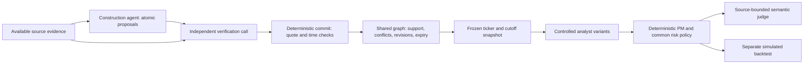

# FinDynamicGraph Agent

Dissertation: Dynamic Evidence-Grounded Financial Knowledge Graph for Multi-Agent Simulated Trading

## Project Overview

FinDynamicGraph Agent uses a time-versioned knowledge graph to evaluate
multi-agent simulated trading on Hong Kong equities. The dissertation workflow
builds a separate evidence snapshot for each stock and decision cutoff. An
independent verifier checks proposed claims before the graph accepts them.

### Current dissertation workflow

- `thesis` imports explicitly supplied Hong Kong evidence and market files.
  It tracks source versions, southbound holdings, and A/H premiums. Evidence
  must be available strictly before the decision cutoff.
- The experiment mines 2–4-hop rules on training snapshots and freezes the
  rules before evaluation. Mining samples up to 32 partial paths per depth and
  stock-date snapshot using a recorded seed, then generalizes each path into
  relation atoms with shared variables. Four analysts receive source-backed paths. The
  portfolio manager combines scores derived from three class log probabilities.
- Each monthly decision forms a standalone equal-weight portfolio from the top
  and bottom 35% of eligible stocks, rounding each side down. Positions open
  at the next session's open and close at the fifth session's close. Daily
  rolling mode is optional and allocates 20% of initial capital to each batch.
- `thesis-replay` recomputes retrieval, scores, and portfolio settlement from
  saved inputs. The offline suite passed 295 tests, including a synthetic
  end-to-end run. Real historical source coverage and live model compatibility
  still require validation.

See [Dissertation protocol](#dissertation-protocol-thesis_v1) for commands and
input formats, and [PLAN.md](PLAN.md) for experiment status.

### Historical four-system comparison

| System | Description |
|---|---|
| `no_kg_no_evidence` | Pure LLM with no data or KG |
| `evidence_no_kg` | LLM with raw OHLCV + news text, no KG |
| `static_kg` | Full multi-agent KG pipeline with frozen graph (pre-experiment cutoff) |
| `kg_dynamic` | Proposed system: temporal KG with dynamic updates |

The focused preliminary runner uses the clearer output labels `direct_llm`
and `text_rag` for the first two historical baseline names.  The full legacy
experiment keeps its existing names for backward compatibility.

---

## Environment Setup

### Prerequisites

- Python 3.11+
- Neo4j 5.x for the collection and Neo4j-backed experiment commands
- OpenAI-compatible LLM endpoint for live model runs

### Installation

```bash
py -3.11 -m venv .venv
.venv\Scripts\activate
python -m pip install --upgrade pip
pip install -r requirements.txt
```

### Environment Variables

Create `.env` in project root:

```env
# Neo4j
NEO4J_URI=bolt://127.0.0.1:7687
NEO4J_USER=neo4j
NEO4J_PASSWORD=your_password
NEO4J_DATABASE=neo4j

# News collection (Tavily)
TAVILY_API_KEY=your_key
NEWSAPI_API_KEY=your_api_key

# LLM (OpenAI-compatible endpoint)
LLM_API_BASE=your_llm_api_base
LLM_API_KEY=your_key
LLM_MODEL=your_model_name
LLM_TIMEOUT_SECONDS=60
LLM_TEMPERATURE=0.2
```

---

## Historical Experiment Usage

### 1. Data Collection

```bash
python -m src.main_collect
```

Collects OHLCV market data, news (Tavily), global news, and fundamentals for
configured tickers. Writes raw parquet files to `data/raw/market_news/<ticker>/`.
Ingests data into Neo4j if configured.

### 2. Run Experiment

```bash
python -m src.main_experiment
```

Runs all four systems across all tickers and trade dates. Outputs:
- `data/experiments/trades_latest.csv` — full trade-level results
- `data/experiments/trades_latest.parquet` — same, columnar format
- `data/experiments/results_summary_latest.csv` — aggregated metrics by system
- `data/experiments/case_study_candidates.csv` — selected cases for dissertation
- `data/experiments/trades_<timestamp>.csv` — timestamped archive

### 2a. Run the focused preliminary experiment

```bash
# Auto-select 5 high-news-volume market dates for 0700.HK
python -m src.eval.run_preliminary --ticker 0700.HK

# Or fix the 4–6 dates explicitly
python -m src.eval.run_preliminary --ticker 0700.HK --dates 2025-01-15 2025-03-19 2025-05-14 2025-08-13
```

This read-only KG experiment writes
`data/experiments/preliminary_results.jsonl` and
`data/experiments/preliminary_results.csv`.  Every system has the same schema,
including temporal audit counts/rates and retrieval/total latency.  The run
fails if any retrieved item is from the future or if all dynamic snapshots are
identical across the selected dates.

### 3. Inspect KG Snapshot

```bash
python -m src.scripts.inspect_snapshot --ticker 0700.HK --date 2024-06-01
python -m src.scripts.inspect_snapshot --ticker 0700.HK --date 2025-06-01
```

Shows active signals, claims, evidence, conflicts, and freshness at a given date.
Add `--save` to write JSON to `data/experiments/`.

### 4. Inspect Decision Trace

```bash
# By ticker + date (searches trades_latest first, then Neo4j)
python -m src.scripts.inspect_decision_trace --ticker 0700.HK --date 2025-06-01

# By decision ID (from Neo4j)
python -m src.scripts.inspect_decision_trace --decision-id decision:0700.HK:2025-06-01
```

Shows action, scores, evidence, claims, agent assessments, and backtest outcome.

### 5. Export Decision Trace (JSON + Markdown)

```bash
python -m src.scripts.export_decision_trace \
    --decision-id decision:0700.HK:2025-03-01 \
    --output data/experiments/trace_0700_2025-03-01.json \
    --markdown-output data/experiments/trace_0700_2025-03-01.md
```

Exports full provenance chain: SourceDocument → Evidence → Claim → AgentAssessment → DecisionTrace → BacktestOutcome.

### 6. Temporal Divergence Proof

```bash
# Export snapshots at two dates
python -m src.scripts.export_graph_snapshot \
    --ticker 0700.HK --as-of 2025-01-01 \
    --output data/experiments/snapshot_0700_2025-01-01.json

python -m src.scripts.export_graph_snapshot \
    --ticker 0700.HK --as-of 2025-03-01 \
    --output data/experiments/snapshot_0700_2025-03-01.json

# Diff the snapshots
python -m src.scripts.diff_snapshots \
    --a data/experiments/snapshot_0700_2025-01-01.json \
    --b data/experiments/snapshot_0700_2025-03-01.json
```

### 7. Run Tests

```bash
# Offline tests (default; network blocked)
python -m pytest

# External checks: use a disposable test database and environment credentials
python -m pytest --integration -m integration

# Collection only, including external tests: no service connections
python -m pytest --integration --collect-only -q

# Specific test files
pytest tests/test_grounding_metrics.py
pytest tests/test_experiment_outputs.py
pytest tests/test_decision_trace.py
pytest tests/test_dynamic_query.py
pytest tests/test_evidence_chain.py
```

---

## Output Files

| Path | Format | Description |
|---|---|---|
| `data/experiments/trades_latest.csv` | CSV | Full experiment results (all systems, all dates) |
| `data/experiments/trades_latest.parquet` | Parquet | Same, columnar format |
| `data/experiments/results_summary_latest.csv` | CSV | Aggregated metrics by system |
| `data/experiments/case_study_candidates.csv` | CSV | Selected cases for dissertation analysis |
| `data/experiments/snapshot_<ticker>_<date>.json` | JSON | KG subgraph at a point in time |
| `data/experiments/trace_<ticker>_<date>.json` | JSON | Decision trace with full provenance |
| `data/experiments/trace_<ticker>_<date>.md` | Markdown | Human-readable case study |
| `data/raw/market_news/<ticker>/ohlcv_2021_now.parquet` | Parquet | Raw OHLCV data |
| `data/raw/market_news/<ticker>/news_latest.parquet` | Parquet | Raw news data |

---

## Metrics

### Trade Metrics

| Metric | Description |
|---|---|
| `n_decisions` | Total decisions per system |
| `n_trades` | Executed trades (buy/sell) |
| `trade_execution_rate` | n_trades / n_decisions |
| `win_rate` | Fraction of profitable trades |
| `directional_accuracy` | Fraction with positive return |
| `abstain_rate` | Fraction of abstain decisions |
| `mean_return` / `median_return` | Return statistics |
| `mean_confidence` | Average decision confidence |
| `mean_conflict_level` | Average inter-agent conflict |

### Grounding Metrics

| Metric | Description |
|---|---|
| `evidence_coverage` | Decisions with ≥1 evidence ref / total |
| `citation_precision` | Valid evidence refs / all refs |
| `claim_coverage` | Decisions with ≥1 claim ref / total |
| `unsupported_claim_rate` | Decisions with reason but no claims / total with reason |
| `stale_evidence_rate` | Stale evidence / total evidence |
| `temporal_precision` | Records valid at the decision date / records retrieved |
| `future_evidence_rate` | Future records / records retrieved (must be 0) |
| `retrieval_latency` | Seconds spent loading evidence or a KG snapshot |
| `total_latency` | End-to-end seconds for retrieval, decision, and audit |

---

## Current Limitations

1. **KG density:** Technical signal nodes dominate; news/fundamental nodes are sparser.
2. **Grounding metrics:** Use conservative approximations (presence-based, not semantic matching).
3. **LLM dependency:** `kg_dynamic`, `evidence_no_kg`, and `no_kg_no_evidence` require a working LLM endpoint.
4. **Neo4j dependency:** Experiment pipeline requires a running Neo4j instance.
5. **Data coverage:** Limited to 3 HK stock tickers. Yahoo Finance may have gaps around HK holidays.
6. **Backtest realism:** No slippage, volume constraints, or market impact. Transaction cost is 5 bp per side.
7. **Case study selection:** Heuristic-based; does not use outcome information for all criteria.

---

## Architecture

```
src/
├── agents/           # Multi-agent system (news, technical, fundamental, risk, orchestrator)
├── collectors/       # Data collection (OHLCV, news, fundamentals, global news)
├── eval/             # Evaluation (metrics, baselines, grounding)
├── kg/               # Knowledge graph (schema, update_pipeline, query, store_neo4j)
├── llm/              # LLM client and prompts
├── scripts/          # Inspection and export scripts
├── sim/              # Backtest simulation
├── utils/            # Retry, rate limiting, I/O
├── main_collect.py   # Data collection entry point
└── main_experiment.py # Experiment entry point
```

---

## Experiment Protocol

The full experiment compares the same four systems on three Hong Kong equities:

| Ticker | Company |
|---|---|
| 0005.HK | HSBC Holdings |
| 0700.HK | Tencent Holdings |
| 1299.HK | AIA Group |

The full runner uses monthly dates from 2025-01-01 through the runtime current date. The static KG is frozen at 2025-01-01; the dynamic system queries each decision date. The focused preliminary runner uses 4-6 event-rich dates for one ticker.

### Backtest assumptions

| Parameter | Value |
|---|---|
| Execution | Next trading day's open |
| Holding period | Five trading days |
| Exit | Close on the final holding day |
| Transaction cost | 5 basis points per side |
| Position sizing | Full notional per simulated trade |
| Actions | buy, sell, hold, abstain |

### Reproducibility checklist

Before a final run, record the Git commit, Python environment, model name, data snapshot, date range, static cutoff, and backend. Verify that future evidence rate is zero and that dynamic snapshots differ across dates.

Project completion status, remaining work, and acceptance criteria are maintained in [PLAN.md](PLAN.md). Contributor and agent rules are maintained in [AGENTS.md](AGENTS.md).


## Refactored services and reproducible runs

The command entry points remain compatible. Collection and cache policies are in
`src/collectors/service.py` and `cache.py`; graph batch writes and connection
ownership are in `src/kg/ingestion.py` and `connections.py`. Agent reports, legacy
role calls and evidence helpers are separate modules. Portfolio aggregation lives
in `src/agents/pm_deterministic.py`, with the old `roles.py` imports retained.
`src/eval/runner.py`, `outcomes.py` and `reporting.py` separate scheduling,
persistence and exports. Internally created clients are closed by their creator;
injected clients remain the caller's responsibility.

### Protocol selection

`legacy` remains the default and preserves the existing trade columns and latest
output filenames. Every full run also gets a separate run record. Use `pit_v1`
explicitly for the new comparison policy:

```bash
python -m src.main_experiment --protocol pit_v1 --run-id hk_pit_001
python -m src.main_experiment --protocol pit_v1 --run-id hk_pit_001 --resume
python -m src.eval.run_preliminary --ticker 0700.HK --protocol pit_v1 --run-id focused_pit_001
```

Full runs default to `data/experiments`; the preliminary command retains its own
output directory. `--output-dir` overrides either destination. New-protocol reports
are saved inside `<output-dir>/runs/<run_id>/`. Do not combine results from different
protocols or input versions. The full command still uses monthly dates from
2025-01-01 through the current date; extending that grid requires a new run.

In `pit_v1`, a date means the end of that Hong Kong calendar day, converted to UTC.
Each dynamic decision uses one frozen graph for tools, aggregation and audit;
static graphs use a fixed cutoff and are loaded once per ticker per run. Tools
reject other tickers and cutoffs. Records without usable availability times are
excluded. Naive source timestamps are interpreted as Hong Kong time. Daily market
bars use an explicit 16:10 Hong Kong availability assumption; this is a development
policy, not verified historical vendor delivery timing. Source publication times
and revision history still require independent validation.

`raw_return` keeps its existing **net** return meaning. New records include gross
return, transaction cost, actual holding days, window completeness and settlement.
An incomplete holding window is unsettled. New-protocol summaries and paired tests
use only successful, settled tasks, with each comparison matched on ticker/date;
`comparison_coverage.json` reports the effective sample sizes. Degraded neutral or
abstain fallbacks remain visible in trades and task records, but are excluded from
these comparisons.

### Records, retries and offline replay

A run contains `manifest.json`, per-task JSON files, `run_summary.json`, and reports.
The manifest records the protocol, date grid, static cutoff, backtest settings,
model/backend identifiers, prompt digest, Git commit, dirty state and source digest.
Task files retain selected inputs, the actual aggregation snapshot, input hashes,
structured decisions, model responses, errors by stage and available retry counts.
Opaque LangGraph retry counts are recorded as unknown. No credential values or
complete environment dumps are recorded. Prior failed/degraded attempts are kept
under `attempts/` when retried.

Explicit resume skips only successful tasks and checks configuration, model/source
identity and observed input hashes. Failed tasks that did not finish loading input
may acquire previously missing input, but previously observed fields must match.
A changed date grid, model, code or input requires a new run ID.

```bash
python -m src.eval.replay data/experiments/runs/hk_pit_001 --output replay/trades.csv --report-dir replay/reports
```

Replay consumes saved responses and snapshots without credentials, Neo4j or model
calls, and recomputes aggregation, backtests and reports. It does not claim that a
fresh model call will produce the same answer or eliminate model knowledge leakage.
The focused runner retains its original result schema; technical failures are
reported in its `error` field and in the accompanying task records.

The default test suite blocks network access, including test collection. Explicit
integration tests read credentials from environment variables only. A Python 3.11
GitHub Actions workflow collects and runs the offline suite; local acceptance and
unverified external integration status are recorded in [PLAN.md](PLAN.md).


## Versioned evaluation (v2)

Historical evaluation remains the default, including for `pit_v1`. Enable the revised
metrics explicitly for a **new** run:

```bash
python -m src.main_experiment --protocol pit_v1 --evaluation-version v2 --run-id evaluation_v2_01
```

The equivalent Python configuration is
`ExperimentConfig(protocol_version="pit_v1", evaluation_version="v2")`.
The evaluation version is saved in the manifest and task inputs. A version change
cannot resume an existing run. Existing runs and their output files are not migrated.
Offline replay reads the recorded version; older records without it use `legacy`.
The focused preliminary runner retains its existing schema and evaluation behavior.

The v2 definitions are:

- Citation precision checks evidence and claim references against their respective
  retrieved sets. An explicit empty set validates no references. Missing ground truth
  or no citations yields `NaN` (blank in CSV), not a perfect score or a claim of failure.
- Evidence freshness uses a 30-day window across source types for this version;
  exactly 30 days is fresh, and `valid_to <= decision_time` is expired. All known
  availability times must be parseable and no later than the cutoff; age starts at
  the latest of those times. Missing, invalid, future or unmatched evidence is
  `unknown` and is counted separately in KG decisions and traces. Naive timestamps
  follow the existing Hong Kong policy. Freshness never authorizes future inputs.
- Stale evidence rate uses only classified fresh/stale references; no classified
  evidence yields `NaN`. The summary also reports `unknown_evidence_count` so missing
  metadata is visible. This policy does not establish semantic faithfulness.
- Directional accuracy and McNemar correctness use positive **gross** return;
  win rate continues to use positive **net** return (`raw_return`). Zero gross return
  is not directionally correct; no executed trades has undefined directional accuracy.
- Each paired test reports its own `n_pairs`, effect difference and, for McNemar,
  `n_discordant`. Duplicate ticker/date/system keys are rejected. Holm correction
  covers all finite p-values in the report; `p_value_adjusted` and
  `significant_adjusted` accompany the original unadjusted fields. Effects are
  system A minus system B. Reports reject mixed evaluation versions.

The historical four-system path retains its prompts, role weights and thresholds.
The independent research protocol below adds semantic evaluation and controlled
comparisons. Source-specific freshness windows, confidence intervals and
dependence-aware inference remain unimplemented.


## Daily HSI preparation and forecasts (hsi_direction_v1)

Research snapshots support five evidence-backed business relationships:
`PARTNERED` (Company–Company), `INVESTED_IN` (investor Company → investee Company)
`SELLS` (Company → Product), `ACQUIRED` (acquirer Company → acquired Company),
and `DIVESTED` (disposing Company → divested Company). Company and product names must occur in supporting
quotes from in-scope news, HKEX disclosures or fundamental source text. A separate
model call verifies relation meaning, endpoint identity/direction and timestamps
before the existing claim ledger can accept a typed business proposal.

For `ACQUIRED` and `DIVESTED`, `transaction_status` must explicitly be `completed`.
The extractor and independent verifier require source evidence of completion;
offers, approvals and pending or cancelled transactions are rejected. The current
scope accepts company targets, with minority investments represented by
`INVESTED_IN`. Partial divestment preserves any separately supported investment
fact; it does not automatically expire ownership or partnership records. Stored
directions distinguish the disposer from the buyer and retain `^ACQUIRED` and
`^DIVESTED` labels for reverse traversal. Prior relation payloads retain their
serialization when the optional transaction-status field is absent.

Business facts are versioned claims with a distinct lifecycle key per relation and
endpoint pair. Different products or partners can coexist. Explicit revisions and
expiry use the existing ledger history. Projection adds business entities and
business edges carrying claim IDs, evidence IDs and exact quotations. Partnership
traversal is symmetric; investment and sales reverse traversal retain an explicit
`^` prefix while stored edges preserve their forward direction. Products are scoped
to their company. Counterparties use normalized names unless an identity mapping is
supplied; the current extractor permits a ticker only for the source owner.

Every selected multi-hop business edge contributes its own supporting quotations
to the API context, including sources supporting intermediate edges. Terminal
`EXTRACTED_FROM` traversal must belong to the preceding business assertion. The
path engine rejects unsupported edges, future facts and mismatched source bindings.
Presence of exact quotes validates provenance; semantic support still depends on
the independent verifier and should be checked with human labels.

The HSI training phase can extract verified business facts from imported historical
news/disclosures before mining rules. The same extraction is applied to test-time
sources. Each new source batch may require construction and verification API calls.
A run-owned cache binds source content, existing business assertions, model settings
and prompts; reused outputs are revalidated against the current cutoff and are only
reused forward in time. Extraction failures are retained in training diagnostics.
Technical-only input creates technical claims. Real corporate relationship coverage
requires explicitly imported historical source text.

The first daily workflow uses ten constituents from the official HSI July 9, 2024
publication (weights as of July 5). This is an explicit pre-2025 selection date.
Training uses 2023–2024 and evaluation uses 2025 exchange sessions. Install the
declared `exchange-calendars` dependency for XHKG trading dates.

```powershell
python -m src.eval.run_research hsi-prepare --output-dir data/experiments/hsi/new_preparation
python -m src.eval.run_research hsi --universe data/experiments/hsi/new_preparation/universe.json --market data/experiments/hsi/new_preparation/market.json --evidence data/experiments/hsi/new_preparation/evidence.json --validate-only
python -m src.eval.run_research hsi --universe universe.json --market market.json --evidence evidence.json --run-id hsi_2025_01
python -m src.eval.run_research hsi-replay data/experiments/hsi/runs/hsi_2025_01
```

Preparation downloads Yahoo historical unadjusted prices and audits missing bars
against the XHKG calendar. Price revisions and corporate actions require independent
validation before interpreting predictive performance. A new output directory is
required. Provide `--news-files` with explicitly authorized source-record JSON files
to import historical news/disclosures in the existing `SourceRecord` format.

With a configured `TUSHARE_TOKEN` and news permission, `hsi-news --output news.json`
collects 2023–2025 short news using bounded, recursively split date windows. Alias
matches identify candidate company associations requiring coverage/manual review.
The token is read from process environment variables. News permission and missing
source coverage remain visible. Recent yfinance/AKShare news cannot establish a
complete 2023–2025 archive. Empty imported evidence yields explicit `no_news` states.

The run constructs exact-quote-verified technical claims from each day's close,
prior-session return and trailing MA20. Missing bars stay missing. Optional source
claims are constructed and independently verified through separate model calls on
the same configured API before freezing each stock/date graph. This version builds
each day from eligible source versions; it does not yet maintain a cross-day
intervention-memory ledger.

The HSI CLI now defaults to `--retrieval trace`, and full batches use the same
rule-only selection. Training mines 2–4-hop patterns with UP and DOWN heads,
support at least five and confidence at least 0.60. Exploration uses beam eight,
depth three, strict confidence greater than 0.60 and at most five terminal-source
paths. It ranks completion, coverage, recency and low hub degree with stable ties.
The company root, support count, bounded sampling and heuristic selection are
explicit adaptations to this graph. No eligible paths means a recorded retrieval
failure with zero analyst calls. Historical direct/rules modes remain explicitly
selectable for earlier experiments.

A small official-issuer seed collector is available without a news subscription:

```powershell
python -m src.eval.run_research hsi-public-news --output-dir data/experiments/hsi/public_sources_NEW
python -m src.eval.run_research hsi-relation-trial --evidence data/experiments/hsi/public_sources_NEW/evidence.json --market data/experiments/hsi/prepared_20261118_02/market.json --output-dir data/experiments/hsi/relation_trial_NEW
```

The relation trial uses credentials already present in process environment variables;
the research CLI does not load `.env`. The collector currently selects four Tencent
and HSBC issuer pages, not an exhaustive news feed. It saves raw HTML, body hashes,
source URLs and visible publication dates. Date-only articles become available at
00:00 UTC the following day. HTML whitespace is normalized before inference and
hashing; original HTML is retained. Current historical pages do not independently
prove the original archived version. These records can also be supplied explicitly
as `hsi --evidence .../evidence.json` with the existing market/universe inputs.

The trial constructs and independently verifies one document at a time in publication
order, retains failed/rejected proposals and mines only 2023–2024 labels. It saves
frozen business-only graphs and explores at the 2025-01-02 cutoff; analyst calls
occur only for eligible paths. It is a bounded diagnostic, not the full HSI model or
sentiment evaluation. After a construction error it stops further construction.
Issuer-rooted `HAS_VERIFIED_<RELATION>_CLAIM -> SUPPORTED_BY` paths expose relation
categories even when the actual endpoint is an unlisted subsidiary. These links
mean source-owner claim provenance, not issuer/subsidiary identity or a direct deal
by the listed parent. Actual business triples keep their original typed endpoints.
This is an explicit local path-language adaptation to the TRACE-inspired approach.

Business extraction/verification uses `business_shared_prefix_v1`: both calls have
the same fixed system rules and proposal/review schemas, followed by identically
serialized source evidence and shared context. The selected task and verification
candidates appear last. Verification remains a separate call with the original
source; quote checks and admission gates are unchanged. The prompt/schema digest
is part of the local extraction-cache identity, so older prompt results cannot be
silently reused. Provider cache-hit improvements require a separate live measurement.

Only selected path facts and their exact source quotations enter the analyst and
subsequent prediction-review requests. The full frozen graph stays in local audit
records. API report references are checked against the selected IDs. Fixed rules
and the output schema appear first in an identical system prompt. Stock/date and
canonical retrieved context precede the role-specific task in the user prompt.
Nested context keys and selected business entities have deterministic ordering;
news-only sentiment follows the role task, after the common evidence prefix.
This promotes shared-prefix reuse across the four analyst calls. Usage records
include provider cache-hit and cache-miss token counts when returned. New prompt
or retrieval settings require a new run identity; paused older runs cannot be
resumed against these changed code identities.

Four variants are available: `full`, `article_only`, `no_sentiment`, `single_agent`.
They share persisted graphs and cached sentiment per mode. Article/company sentiment
uses exact article quotes and up to four verified company-background triples whose
sources precede the article. No eligible background remains `no_background`.
All four roles see the same evidence context; only the news role additionally sees
the sentiment feature. The integrated call returns the same four reports. A common
8,192 response-token budget is split over four calls or assigned to the integrated
call. All forecasts use the fixed weighted scores and preserve source references.

`--tickers`, `--dates` and `--variants` select a pilot before a full run. `--resume`
requires matching code/model/input/configuration identities, reuses successful tasks
and preserves failed attempts. Outputs include per-variant frozen forecasts,
training rules, task/call diagnostics, graph construction and classification summaries.
Classification summaries describe each variant's own successful labeled sample;
`hsi_paired.json` separately compares each arm with full on matched successful
stock/date keys, including the actual paired counts.
Review a generated `<variant>_forecasts.json` using `prediction-review` below.
The current daily runner generates direction predictions without portfolio simulation.

For full market-only forecasts, `hsi-batch` runs one full-variant shard per stock
with bounded parallelism. The same API configuration is copied into independent
clients. Each shard retries its failed tasks once, preserving earlier attempts,
and passes offline replay before aggregation.

```powershell
python -m src.eval.run_research hsi-batch --universe universe.json --market market.json --evidence evidence.json --run-id hsi_full_01 --workers 10
python -m src.eval.run_research hsi-batch-replay data/experiments/hsi/runs/hsi_full_01
```

`batch_progress.json` records completed stocks and shard errors. Each shard saves
individual task records as it runs. `batch_summary.json` and `full_forecasts.json`
are written after all workers finish. Use the same command with `--resume` to reuse
intact shard successes. The batch identity fixes data, code, model and prediction
settings; worker count may change without changing the task inputs. A 246-session
2025 calendar and ten stocks produces 2,460 forecasts, of which the final session
per stock has no within-2025 next-session label. Review generation is a separate
explicit command after forecasts finish.

## Frozen direction prediction review (prediction_review_v1)

The review evaluates four-role forecasts already produced by the upstream system.
It fixes the original weighted score and direction before requesting an independent
review. The reviewer sees analyst reports and time-eligible source evidence. The
exchange calendar and next-session closes are used only by the evaluation code.

```powershell
# Export a previously authorized research run into a new file outside that run.
python -m src.eval.run_research freeze-predictions <research-run-dir> --system full_graph --output forecasts.json
# Credentials are supplied through process environment variables.
python -m src.eval.run_research prediction-review --predictions forecasts.json --market market.json --output-dir prediction-reviews --run-id review_01
python -m src.eval.run_research prediction-review-replay prediction-reviews/runs/review_01
```

The export retains completed four-role decisions even when their original semantic
evaluation failed. Its provenance sidecar records those source statuses and hashes.
Directions are derived from the original role scores, confidences and fixed weights:
positive predicts UP, otherwise DOWN. This is a direction diagnostic on fixed reports.
Preparing the daily HSI data and generating its forecasts remain separate steps.

Alternatively provide a JSON list of forecasts with `ticker`, ISO `date`, `reports`
and `snapshot`. Reports are keyed by `technical`, `news`, `fundamental`, `risk` and use
the existing `AgentReportSchema`. The snapshot contains `evidences` (each with
`ticker`, `evidence_id`, `text`, and an explicit availability timestamp such as
`published_at`) and `claims` (with `ticker`, `entity_id` and availability timestamps).
All referenced IDs must belong to that stock's eligible snapshot. Market input uses
`sessions` and `prices` with `ticker`, ISO `date` and positive `close` or null. The
calendar determines the immediate next session; missing marks remain unlabeled,
and cross-year labels are excluded. Flat closes are DOWN.

The review returns atomic evidence judgments and a quoted assessment of the written
reasoning's direction. Deterministic validation checks exact source and analyst
quotes, complete citation IDs and nonempty judgments. A contradiction or an opposite
reasoning direction produces `conflicting`; mixed, insufficient or unlocated support
produces `insufficient`; complete aligned support produces `supported`. Validating
quotes establishes their presence; the semantic judgments still need independent
human validation. Review failures retain their original forecasts and diagnostics.

`prediction_review_summary.json` includes all labeled forecasts, successfully
reviewed forecasts, category-specific Accuracy/Precision/Recall/F1 and sample counts,
and the supported subset's retention rate. Failed reviews remain in the overall
forecast denominator. Add `--resume` to retry failures with identical input, model,
configuration and code identities; successful reviews are reused and prior attempts
are archived. Offline replay validates input hashes, original scores, review rules,
task coverage, labels and the saved summary.

## Core research protocol (research_v1)

The user-confirmed implementation scope is three Hong Kong stocks (`0005.HK`,
`0700.HK`, `1299.HK`), daily bars, four financial analysts and deterministic PM.
This reduces the proposal's approximate 80-stock/minute-data/bull-bear-role scope
so graph collaboration and evaluation can be studied with controlled, inspectable
inputs. It limits market, frequency and architecture generalization. Supervisor
confirmation is still pending; user confirmation is not academic approval.

This protocol has its own CLI and run directory. It requires `pit_v1` and v2
metrics; the historical four-system workflow remains available.



`src/kg/collaboration.py` stages construction and verification **before** freezing
the decision snapshot. Models propose structured claims, never arbitrary Cypher.
Claims must name subject, predicate, metric and reporting period and quote all
cited sources. A separate verifier call checks support, then deterministic checks
reject wrong tickers, unknown/future/expired sources and invented quotes. The
verifier can use a different model via `RESEARCH_VERIFIER_MODEL`; a separate call
using the same model is not independent human validation.

Different metrics/periods coexist. Same-fact disagreements create conflict edges;
explicit verified revisions create `SUPERSEDES`, close the previous interval and
retain its support and event history. Expiry preserves history. Historical views
omit later revision metadata. Ledger and update hashes are saved before any
analysis; a failed store commit does not advance memory.

By default, shared state is run-owned JSON plus an in-memory graph. Explicit
`--persist-research-graph` writes isolated `ResearchGraphState`, `ResearchClaim`,
`ResearchEvidence` and `RESEARCH_LINK` records using a Neo4j transaction, uniqueness
constraints and state-digest conflict checks. These writes do not update the
production collection schema. Real Neo4j integration is still unverified.

| Variant | Controlled change from full_graph |
| --- | --- |
| full_graph | Dynamic verified graph, citation validation, four analyst calls |
| text_same_evidence | Linear rendering of exactly the same facts and relationships |
| no_grounding | Same graph; citations optional and citation validation disabled |
| single_agent | One integrated call produces the same four role assessments |
| static_graph | Frozen copy of the verified initial graph that seeds full_graph |

The first three ablations require identical evidence hashes on matched ticker/date
keys. All groups use the original PM weights/thresholds, fixed holding period and
cost model. Total response-token caps match (default 2048: four calls at 512 versus
one at 2048). Call count and prompt-character totals are exported. Input-token use
is not matched. The graph/text comparison tests **representation**, not Neo4j
traversal. The static comparison changes freshness and coverage after both groups
start from one verified ledger. Each task records the initial ledger digest.
Eligible technical and fundamental rows are exposed as derived evidence with
explicit metric fields, including the reporting period when the source supplies it.
`no_grounding` measures the combined citation-requirement/validation mechanism,
not the effect of removing evidence. Per-variant failure/settlement counts and each
paired test's sample size are reported; failed rows never become neutral successes.
The paired research report also records full-graph-minus-ablation differences in
net trade return, abstention rate and claim support rate. The support difference
uses only pairs with scored statements on both sides.

The semantic judge evaluates actual summaries, factors and rationale using only
the frozen corpus. Atomic factual statements and inferences are labelled supported,
contradicted or not_found; source quotes are checked exactly. Exports include
faithfulness, unsupported-unit rate, factual hallucination rate and semantic
citation precision. Key-evidence recall requires independently supplied annotation
IDs; absent annotations produce blank coverage. Static groups may miss keys from
the independent dynamic reference corpus and are scored as misses. The inspectable
judge cache records rubric/model/input/response hashes; malformed evaluations are
failed tasks, not perfect scores. `annotation_agreement` computes human/judge
agreement and Cohen's kappa from supplied paired labels; no human labels are
fabricated. Judge decomposition completeness and semantic labels still need human
validation. No later price return is supplied to the judge.

`conservative_v1` applies the same rule to all groups: no fresh evidence -> abstain;
active same-fact conflicts -> hold. `--risk-policy observational` disables that gate
for measuring model behavior. Risk reports are conditional on each evidence state,
not an unconditional abstain percentage. The synthetic benchmark fixes bullish
reports and tests the policy; it cannot establish model risk understanding.

All credentials must already be in process environment variables. This CLI does
not read dotenv files. Optional `RESEARCH_ANALYST_MODEL`,
`RESEARCH_CONSTRUCTOR_MODEL`, `RESEARCH_VERIFIER_MODEL`, `RESEARCH_JUDGE_MODEL` select
models on the configured provider without recording credential values.
For DeepSeek, `LLM_DEEPSEEK_THINKING=disabled` disables thinking for direct model
calls while retaining the configured model and response-token caps. The run
records this setting. Use a new run ID when changing it.

```bash
# Focused real calls on explicitly authorized saved inputs; requires LLM environment
python -m src.eval.run_research run --source-run data/experiments/runs/full_pit_20261004_01 --tickers 0700.HK --dates 2025-03-01 2025-04-01 --run-id research_focused_01
# Omit --source-run to read the configured Neo4j + parquet sources
# Independent annotations: --key-annotations path/to/key_evidence_ids.json
# Resume only with identical code/configuration/input: add --resume
python -m src.eval.replay data/experiments/research/runs/research_focused_01 --output replay/research.csv --report-dir replay/research_reports
# Read-only review of user-authorized historical records, into a separate directory
python -m src.eval.run_research historical-review data/experiments/runs/full_pit_20261004_01 --output-dir data/experiments/research_reviews/full_pit_20261004_01
# Offline fixed-report policy and memory timing check
python -m src.eval.run_research risk-benchmark --output-dir data/experiments/research_checks/research_v1 --repetitions 20
```

The evidence perturbation diagnostic reruns the analyst on four views of each
selected successful `full_graph` snapshot. It compares the original with a view
without a key evidence item, one without a critical relation, and one without a
control evidence item. It records confidence changes and actions before and
after the risk policy. It uses new model calls with the source run's response
cap and risk policy, and writes results to a separate directory.

```bash
python -m src.eval.run_research evidence-perturbation <authorized-research-run> --cases cases.json --output-dir <new-output-dir>
```

Provide an independently annotated JSON list. Each entry contains `ticker`,
`trade_date`, `key_evidence_id`, `control_evidence_id`, and a
`critical_relation` object with `start_id`, `end_id`, and `type`. Select
the two distinct evidence IDs and the edge from the same frozen snapshot.

### Rule constrained multi-hop retrieval

The `multihop` diagnostic compares three retrievers on one saved, successful
`full_graph` snapshot per stock and decision date. All three use the same query,
candidate source evidence and top-k cap. The graph arms select the same
lexically matched seed claims. The one-hop arm follows direct support. The
multi-hop arm adds two fixed rules over actual frozen edges:

| Rule | Path | Interpretation |
| --- | --- | --- |
| Direct support | Claim → evidence | Source supporting a seed claim |
| Conflicting support | Claim → conflicting claim → evidence | Source behind a competing account of the same fact |
| Shared source support | Claim → common source → related claim → other evidence | Additional context reached through a shared source |

The last rule follows a support edge in reverse when moving from a source to a
claim. A common source establishes a link for retrieval. The linked claims can
still differ in meaning. Paths require in-scope nodes, eligible timestamps and
exact quotes on support edges. The lexical baseline ranks source text by query
term overlap. Graph paths rank by seed overlap, then by conflict, direct support
and shared-source rule priority. The output records the selected IDs, paths,
edge directions as stored, source quotes and evidence reached only by going
beyond one hop. Empty results are reported as empty.

```bash
python -m src.eval.run_research multihop <authorized-research-run> --cases cases.json --output-dir <new-output-dir> --top-k 4 --seed-limit 4
```

The cases file is a JSON list with one entry per stock and date. Write the query
from the research task before inspecting trade outcomes. The optional key
evidence IDs must come from independent annotations within the frozen corpus.

```json
[
  {
    "ticker": "0700.HK",
    "trade_date": "2025-03-01",
    "query": "revenue growth and margin pressure"
  }
]
```

Add `"key_evidence_ids": ["<evidence-id-from-the-snapshot>"]` to report annotated
recall and precision. Add `--ablate-path-rules` to measure each multi-hop rule's
contribution by disabling it while retaining the other rule, direct support,
and the same candidate pool and retrieval limits. The default command is offline. Add
`--evaluate-decisions` to send each arm's selected evidence to the same four
analysts in the same text format, with a common response cap, PM and backtest
settings. The analysts receive the selected evidence while path traces are
exported for inspection. This contrast measures retrieval, separately from
the five-variant representation experiment. Actual retrieved counts and prompt
lengths may differ. The paired summary reports the number of equal-size
contexts, annotated pairs and successful settled decision pairs.

These rules traverse the current claim and source graph. Cross-company event
propagation and the usefulness of the retrieved evidence in real market cases
require separate validation.

Research outputs include task/attempt records, graph update/failed-update records,
`research_execution_coverage.json`, trade/semantic/risk reports, update-stage and
retrieval/decision latency, controlled comparison checks and versioned significance
reports. Resume restores only integrity-checked graph updates and successful tasks;
input/configuration changes require a new run ID. Offline replay recomputes PM,
risk gates, quote-validated semantic arithmetic and returns from saved records.

Latest acceptance and real versus synthetic evidence are in [PLAN.md](PLAN.md).
The 2026-10-04 historical run predates this protocol and does not validate its core
innovation. Source archives, actual collaboration/judge calls, semantic human
agreement and real Neo4j update latency remain separate empirical requirements.

## Dissertation protocol (thesis_v1)

The dissertation entry point uses local files explicitly supplied on the command
line and a run-owned in-memory graph. Training and evaluation ranges are
inclusive and disjoint. The default decision schedule uses the first supplied
exchange session of each evaluation month inside the range. Use
`--decision-dates` to set the schedule explicitly or `--portfolio-mode rolling`
for daily decisions and five overlapping capital sleeves.

```bash
python -m src.eval.run_research thesis --evidence evidence.json --market market.json --train 2025-01-01 2025-04-30 --evaluate 2025-05-01 2025-07-31 --output-dir thesis-output
python -m src.eval.run_research thesis-replay <authorized-thesis-run>
```

The evidence JSON is a list of source excerpts. One illustrative record:

```json
{
  "ticker": "0700.HK",
  "source_type": "southbound_holding",
  "source": "Name of original archive or publisher",
  "document_id": "Stable source record identifier",
  "version": "1",
  "language": "zh-Hant",
  "published_at": "2025-01-02T19:00:00+08:00",
  "text": "Holdings were 100 shares.",
  "period": "2025-01-02",
  "value": 100,
  "unit": "shares"
}
```

Supported types are `hkexnews`, `local_news`, `southbound_holding`, `ah_premium`,
`technical` and `fundamental`. Use `en` or `bilingual` where appropriate.
Provide the source's public time and a unique source-record/version pair. Keep
the same document ID for a correction to the same excerpt and give the
correction a distinct version and later publication instant. Optional
`valid_to` is exclusive. For A/H records, also supply the confirmed `a_share`
code such as `600001.SS`. Use source labels and document IDs without credentials.
Record validation failures are listed in `source_rejections.json`. The graph
uses the latest version strictly before the HK end-of-day cutoff. Training and
analysis see bounded snapshots with source fingerprints and exact quotations
from the stored excerpts, with URLs redacted.

The market JSON contains a complete `sessions` list of Hong Kong exchange
session dates and `prices` rows keyed by `ticker` and ISO `date`, with numeric
`open` and `close` fields. Include the five sessions following the last
decision date. A missing mark can be null. Supply prices on a consistent basis
across each holding period. The exchange calendar drives the holding window
even when an individual stock has a missing bar.

Set model credentials in the process environment. The analyst endpoint must
return `A`, `B` and `C` token log probabilities at the same output position.
The classification normalizes over those three alternatives. Missing or
malformed probabilities fail the stock-date task. A failed stock-date task
fails portfolio selection for that date. The rule library uses training labels
with a fifth-session close strictly before the first evaluation session.
Training and evaluation records report excluded labels, failed graph/model
calls and empty retrievals. Outputs include the manifest, rules, frozen
snapshots and paths, probability reports, the portfolio ledger and summaries.
Replay verifies the saved inputs, retrieval, score aggregation and ledger
without model calls.

Independent mode reports each decision as a standalone five-session portfolio
with 100% gross opening exposure. Rolling mode uses 20% of initial simulated
capital per cohort with up to five simultaneous cohorts. In both modes, the
top and bottom `floor(0.35 * n_eligible)` stocks receive equal shares of the
respective long and short sides. Costs are 5 bp of opening notional on each
side of the round trip. Batch entry requires valid opening prices for all legs.
Missing exit prices leave the batch unsettled. Only fully settled batches
contribute to mean net return.
